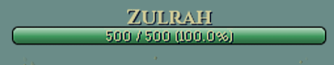
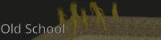
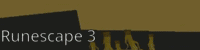

# Better Boss Health Bar

A Runelite plugin that replaces the default boss health bar with a dynamic and customizable one.



## Features

- **Customization**: Customize the boss health bar to suit your needs! Select a style, change the colors, and even tweak the animated properties to perfect your UI.

  
  

- **Animation**: Interpolates boss health smoothly, flashes the bar on each hit, and a visual damage buffer that animates recent damage for a few ticks before draining.

- **HP Display**: Choose to display the boss health as a percentage, hitpoints, or both!

- **Breakpoints**: Configure health bar breakpoints for bosses! See [Breakpoints](#breakpoints) for how to set them up.

## Breakpoints

To configure breakpoints, type the boss name, a colon, and then the breakpoint percentages separated by commas. Boss names are not case sensitive.

```
Alchemical Hydra: 75, 50, 25
Yama: 66, 33
```
